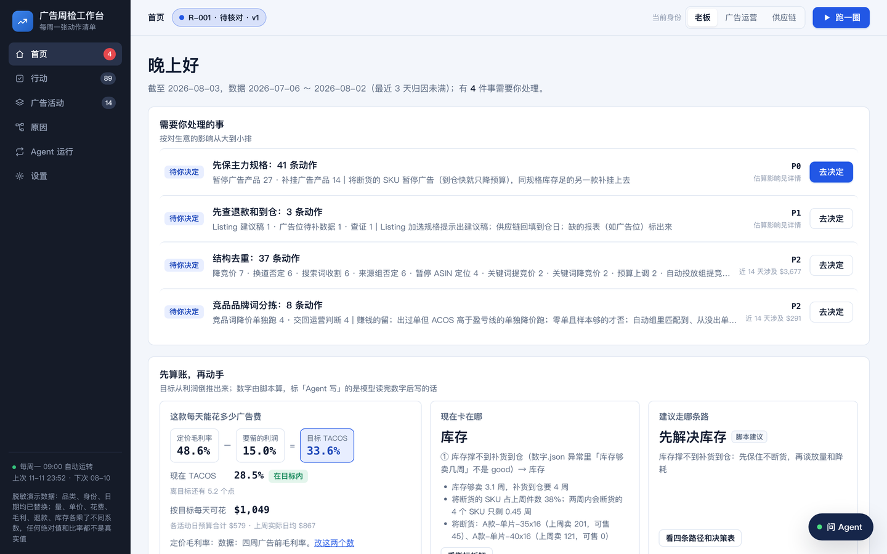

## 🚀 Way to AIC | 通往 AI 电商之路
---
### 🌐 官网 Website
- https://waytoaic.com
- https://www.waytoaic.com
---

### 👥 社群招募 Community
`Way to AIC 社群招募 | WaytoAIC.com`

<p align="center">
  
</p>

---

### 📣 公众号 WeChat Official Account
`维正 WaytoAIC`

<p align="center">
  
</p>

---

### 🧠 知识星球 Xiaozhixing
`AI电商之路 WaytoAIC`

<p align="center">
  
  
</p>

---

### 🧩 About Way to AIC

**AIC = AI Commerce**

在 AI 重塑商业的时代，我们希望和每一个拥抱 AI 的卖家：

- 找到场景
- 定义问题
- 积累能力
- 设计系统

共同通往 AI 电商之路。

> Way to AIC 不是教学，不是工具，
> 而是一条所有电商人共同走的进化之路。

### WaytoAIC 理念 | Principles

| 中文 | English |
|---|---|
| 场景先于方法 | Context before method |
| AI 的价值来自真实业务场景，而不是技术本身。 | AI creates value through real business contexts, not through technology alone. |
| 问题先于答案 | Problem before answer |
| 定义问题，比拥有工具更重要。 | Defining the problem matters more than collecting tools. |
| 系统胜过技巧 | System over tricks |
| 技巧是术，系统才是道，决定卖家的上限。 | Tricks are tactical; systems define long-term leverage and ceiling. |
| 共创优于独行 | Co-creation over solo progress |
| 我们相信，真正的进化发生在共同探索的过程中。 | Real evolution happens through shared exploration. |

# ads-workbench · 广告周检本地工作台 / Local Ads Review Workbench

一个能点、能跑的本地工作台：把「看到 ACOS 高」推进到「有人点头、有日期、能复盘的动作清单」。只用 Python 标准库＋SQLite＋pandas，断网可用，**不连任何广告后台**。

A runnable local workbench that turns an Amazon ads report into a reviewed, dated action list. Python stdlib + SQLite + pandas, works offline, **never touches your ad console**.



## 快速开始 / Quick start

```bash
git clone https://github.com/WaytoAIC/ads-workbench ~/ads-lab
cd ~/ads-lab && pip install pandas && python3 工作台/app.py
```

打开 http://localhost:8810 ，点「跑第一圈」。Mac 也可以双击 `启动工作台.command`。不要放在「桌面」目录下。
Open http://localhost:8810 and click “跑第一圈”.

## 里面有什么 / What's inside

- **Loop 六动作**：读取状态 → 判断下一步 → 执行 → 验证 → 写入状态 → 判断停止条件（`流程图/`，另有项目架构图）
- **六层页面**（左侧导航）：
  1. **总览 · Agent 运行**：这一圈的六格，每格可展开细节
  2. **持续运行 · 历史**：前三圈模拟回放 ＋ 本周真实一圈 ＋ 下一圈，看它是每周跑的，不是一次性的
  3. **① 发现异常**：对照目标，三个人各填自己的输入（目标 ACOS／到仓周数／取舍）＋ 六张指标卡 ＋ 逐项判定表，每行带「引出的分析」
  4. **②分析 ③诊断 ④输出动作**：一张可点的诊断树——异常 → 分析 H1–H6 → 对策 A–E → 动作类型；点节点高亮上下游，下方左结论右证据；对策卡打勾＝选进本轮，变了才出现「按这个取舍重新生成」
  5. **⑤ 分类审批**：按类型分组，通过／驳回必填理由／整类全部通过；状态分段筛选；v1 → v2 对比条；输入变了之后旧确认标「请复核」
  6. **⑥ 执行 · 下周看结果**：四个执行通道卡（Amazon Ads API／SP-API Listing／领星 ERP／人工判断），审批通过的按通道导出批量上传表；标已执行／已验证；复盘日倒计时；行动卡九格；驳回记录、回测、运行历史、操作记录
- 持续运行历史回放（`历史回放.json`）、诊断树（`_脚本/tree.py` 连线）、按通道导出（`_脚本/fields.py` 把动作翻成广告后台字段）
- 权限与状态流转在服务端强制；改一个输入再跑，输出跟着变；人驳回过的下一圈不再提
- `实操手册.html`：学员两轮 18 步｜`学员材料/任务卡.md`：交三样、热身题、三层验收｜`台上操作卡-业务工作台.md`：讲师 7 步｜`数据说明.md`
- 换成自己的数据：`数据格式.md` ＋ 模板 `我的数据-示例/` ＋ `python3 _脚本/import_my_data.py 我的数据 ~/ads-lab-mine`
- 装进 Agent：`python3 _脚本/agent_run.py` 不起网页跑一圈、打印摘要、可推飞书 → `装进Agent.md`

Six-step loop, six-layer review page (overview, history replay, anomalies, a clickable diagnosis tree, grouped approval, execution by channel), server-enforced roles and state transitions, a student handbook with a task card, an instructor card, and a headless agent runner. UI and docs are in Chinese.

## 文件地图 / File map

| 文件 | 干什么 |
|---|---|
| `工作台/app.py` | 后端：Loop 六格、权限、状态流转、导出（标准库＋SQLite） |
| `工作台/index.html` | 页面：六层结构，离线可用 |
| `_脚本/pipeline.py` | 算数、分组、异常、全类型动作规则、验证器（需要 pandas） |
| `_脚本/render.py` | 三栏表、行动卡、运行报告 |
| `_脚本/tree.py` | 诊断树连线：异常 → 分析 → 对策 → 动作类型，以及动作类型 → 执行通道 |
| `_脚本/fields.py` | 动作 → 广告后台字段（Campaign／广告组／关键词／定位／改哪一栏），批量上传表 |
| `_脚本/history_sim.py` | 历史回放：同一套规则对前三圈历史数据跑，生成 `历史回放.json` |
| `_脚本/agent_run.py` | Agent 入口：不起网页跑一圈，打印摘要，`FEISHU_WEBHOOK` 推飞书，失败退出码 2 |
| `_脚本/import_my_data.py` | 把自己的报表整理成工作台能读的样子 |
| `参数.json`／`分组规则.json` | 输入与活动分工／本品类五类词表 |
| `历史回放.json` | 前三圈模拟回放（页面只读） |
| `显示映射.json` | 演示数据的显示层：活动名、ID、广告组（真实数据目录不放它） |
| `_原始拉取/` | 脱敏演示数据 |
| `工作台.db` | 状态库（重置会删掉重建，不入库） |
| `学员材料/任务卡.md` | 学员任务卡：问题、交三样、热身题、跟练路线、三层验收、材料 |
| `装进Agent.md` | cron／launchd、Hermes、飞书机器人三种接法 |
| `实操手册.html`／`台上操作卡-业务工作台.md` | 学员手册／讲师操作卡 |
| `数据格式.md`／`数据说明.md`／`我的数据-示例/` | 换自己的数据／脱敏说明／模板 |
| `流程图/` | 工作台运转流程、项目架构 |

## 数据 / Data

示例是脱敏并替换过品类的演示数据（浴室防滑垫／NORDLY），竞品品牌名全部是编的。换成自己的数据：照 `数据格式.md` 准备一份搜索词报告加三张手填小表，导入后 `python3 工作台/app.py --root <目录>`；真实数据只留在你自己电脑上。
Sample data is desensitized demo data with a substituted category; all competitor brand names are fictional.

## License

MIT
